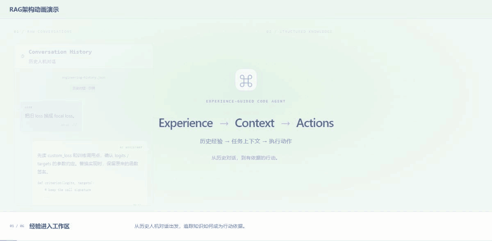

<div align="center">

[简体中文](README.md) · **English**

# Experience-Guided Code Agent

### Turn engineering experience into evidence for code changes.

Retrieve experience. Plan changes. Execute, validate, retry and recover.

[](https://chaomacv.github.io/experience-guided-code-agent/)
[](https://github.com/chaomacv/experience-guided-code-agent/actions/workflows/tests.yml)
[](https://www.python.org/downloads/)
[](LICENSE)

[](https://chaomacv.github.io/experience-guided-code-agent/#knowledge-story)

**RAG architecture animation** · Click for the interactive demo with pause, stage navigation and language switching.

<sub>The animation illustrates loss replacement. The runnable example upgrades a Wine classification service.</sub>

[Quick start](#quick-start) · [Use your own project](#extend) · [Documentation](docs/README.md) · [Capabilities & extensions](https://chaomacv.github.io/experience-guided-code-agent/#implementation)

</div>

---

## What this project does

Extract traceable engineering experience from historical human–assistant conversations. Retrieve relevant experience to help an LLM plan code changes, apply actions to a project copy, and run an independent validator. Failures feed the next retrieval and planning round; exhausted attempts trigger checkpoint recovery and a byte-for-byte comparison.

**The deliverable is validated code and execution evidence.** Successful runs export code, a patch and hashes. Failed runs record the failure and recovery outcome. The model generates structured plans and file actions; validation rules are fixed before execution.

| Stage | Implementation | Source |
| --- | --- | --- |
| Knowledge Preparation | Dialogue → LLM-extracted Case → semantic chunks → index, with provenance | [case_pipeline/](experience_guided_code_agent/case_pipeline/) |
| RAG Retriever | BGE-M3 Dense + BM25 → RRF; module filtering and per-Case limits | [retriever.py](experience_guided_code_agent/rag/retriever.py) |
| LLM Planner | Task + past experience + Repository Facts + Skill → Plan / Actions | [planner.py](experience_guided_code_agent/agent/planner.py) |
| Executor / Validator | Allowlisted file writes; independent business checks with exit codes and logs | [executor.py](experience_guided_code_agent/agent/executor.py) |
| Orchestration | Deliver on PASS; retrieve and replan on FAIL; Rollback & Verify after exhaustion | [workflow.py](experience_guided_code_agent/agent/workflow.py) |

The [12-capability mapping](docs/agent_module_mapping.md) documents implementation scope and remaining work. The project currently uses a text LLM. MLLM support, automatic experience write-back and an operating-system sandbox are not implemented.

<a id="quick-start"></a>

## Quick start: reproduce the demo

**Task: upgrade a Wine classifier from nearest centroid to random forest, preserving its API, response fields and legacy fallback.**

| Component | Data and behavior |
| --- | --- |
| Business data | UCI Wine: 178 real measurement records; 124 training / 54 independent validation records |
| Experience corpus | 12 authored human–assistant conversations, 96 messages; 6 relevant and 6 distracting conversations |
| Live execution | DeepSeek extracts experience and generates changes; real file actions and independent validation run locally |
| Validation | Interface, actual model invocation, quality regression, edge cases and legacy fallback |

Use **Python 3.10–3.12**, a model API key, and network access to download BGE-M3. CPU execution is supported; a GPU can accelerate embedding. The first run downloads the model. The index supports NumPy by default and uses FAISS when installed. Pinned dependencies are in [requirements.txt](requirements.txt).

**1. Clone and create an environment**

```bash
git clone https://github.com/chaomacv/experience-guided-code-agent.git
cd experience-guided-code-agent
python -m venv .venv
```

**2. Activate, install dependencies and set the key**

Linux / macOS:

```bash
source .venv/bin/activate
python -m pip install -r requirements.txt
export DEEPSEEK_API_KEY="your-key"
```

Windows PowerShell:

```powershell
.\.venv\Scripts\Activate.ps1
python -m pip install -r requirements.txt
$env:DEEPSEEK_API_KEY="your-key"
```

The CLI reads environment variables and does not automatically load `.env`. Model names, API URLs and attempt limits are in the [default configuration](configs/wine_practice.json). For another API, see the [provider guide](docs/llm_providers.md).

**3. Run the complete workflow**

```bash
python scripts/run_practice.py
```

**Business data preparation → dialogue extraction → chunks / index → retrieval → LLM planning → file edits → independent validation → delivery / retry / rollback.** API usage is billed by your provider; model responses and attempt counts are not fixed.

### Inspect the delivery and evidence

Open `outputs/runs/<RUN_ID>/report.html` at the path printed by the CLI:

| Artifact | Contents |
| --- | --- |
| `conversations/` · `extraction_audit/` · `cases/` | Original messages, extraction responses and provenance |
| `knowledge/` · `index/` | Chunks, vectors and index metadata |
| `attempts/` | Queries, retrieval, prompts, model responses, actions and validation logs for each attempt |
| `workspace/` · `checkpoint/` | The modified project copy and original snapshot |
| `delivery/` | Code, patch and SHA-256 hashes exported only after PASS |
| `final_report.json` · `report.html` | Final status, attempt history and recovery outcome |

Existing evidence: [dialogue-based run notes](docs/history_dialogues.md) · [saved execution report](https://chaomacv.github.io/experience-guided-code-agent/history-live-report.html).

<a id="extend"></a>

## Use your own project

Reuse the orchestration loop and supply your own experience corpus, target project and business validation rules.

| What to replace | Start here |
| --- | --- |
| Historical conversations, Case schema and knowledge preparation | [Knowledge Preparation](docs/knowledge_preparation.md) |
| Embedding, indexing or another RAG / retrieval pipeline | [Retriever extensions](docs/retriever_extensions.md) |
| DeepSeek, a compatible API or a custom provider | [LLM Provider](docs/llm_providers.md) |
| Target repository, editable files and execution tools | [Project Adapter / Executor](docs/project_adapter.md) |
| Interface, runtime, regression and fallback checks | [Independent Validator](docs/validator.md) |
| Delivery, retry limits and checkpoint recovery | [Execution & Validation](docs/execution_validation.md) |

Configurations: [Wine demo](configs/wine_practice.json) · [compatible API](configs/openai_compatible_example.json). The generic entry point is `python -m experience_guided_code_agent.cli`; see the [command reference](docs/commands.md) for individual stages. The [capability explorer](https://chaomacv.github.io/experience-guided-code-agent/#explore-llm) links to external projects and official documentation. Listed resources are references, not existing integrations. Detailed guides currently use Chinese, with source paths and commands in English.

## Repository layout

```text
experience_guided_code_agent/  Reusable knowledge, RAG, planning, execution and reporting
configs/                       Business-run and model API configuration
examples/
  history_dialogues/            Authored dialogue, provenance and evaluation labels
  wine_service/                 Task, legacy service, data and independent validator
scripts/                       Run, prepare, evaluate, export, check docs and package
tests/                         Automated tests; fixtures/ contains controlled branch tests
docs/                          Usage and extension guides; media/ holds README assets
  evidence/ · evaluation/       Saved execution and evaluation evidence
  archive/                     Earlier experiments
benchmarks/                    Separate synthetic retrieval benchmark, not the demo corpus
showcase/                      Bilingual static project page and saved reports
outputs/                       Generated runtime artifacts, excluded from Git
```

## Data, evidence and boundaries

- **The conversations are authored examples.** The [corpus](examples/history_dialogues/README.md) is not customer data. A conversation claiming “tests passed” is not an independent validation result.
- **The business data has a public source.** The [Wine data notes](examples/wine_service/README.md) describe provenance, the split and CC BY 4.0 licensing. Holdout labels are excluded from the planning context.
- **Historical evidence is inspectable.** The [run notes](docs/history_dialogues.md) preserve one real run with 12 Cases / 36 Chunks. The [retrieval evaluation](docs/evaluation.md) and [earlier experiment](docs/archive/diagnostic-practice.md) document their own data and limitations.
- **One passing run does not establish success rate or RAG benefit.** Allowlists, fixed commands and integrity checks are not an operating-system sandbox. Use an isolated environment for untrusted code.

## Development and maintenance

Core checks require no model download or API calls:

```bash
python -m pip install -r requirements-core.txt "scikit-learn>=1.4,<1.8"
python -m pytest -q
python scripts/check_docs.py
```

Controlled model responses in tests exercise failure, retry and rollback. They are not used by the default live workflow. Preview the project page and build its source download:

```bash
python scripts/package_showcase.py
python -m http.server 8080 --directory showcase
```

Open `http://localhost:8080/`. See [showcase maintenance notes](showcase/README.md) for the frontend file map.

[Contributing](CONTRIBUTING.md) · [Security](SECURITY.md) · [MIT License](LICENSE)
