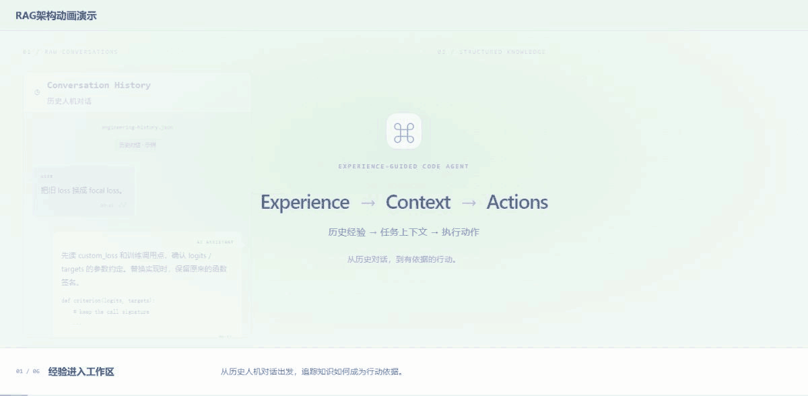

<div align="center">

**简体中文** · [English](README.en.md)

# Experience-Guided Code Agent

### 工程经验驱动的代码变更 Agent

让历史工程经验，成为 Agent 的行动依据。

[](https://chaomacv.github.io/experience-guided-code-agent/)
[](https://github.com/chaomacv/experience-guided-code-agent/actions/workflows/tests.yml)
[](https://www.python.org/downloads/)
[](LICENSE)

[](https://chaomacv.github.io/experience-guided-code-agent/#knowledge-story)

**RAG 架构动画演示** · 点击查看可暂停、跳转与中英切换的交互版。

<sub>动画以 loss 替换说明信息流；可运行案例是 Wine 分类服务的算法替换。</sub>

[快速复现](#quick-start) · [接入自己的业务](#extend) · [文档导航](docs/README.md) · [能力实现与扩展探索](https://chaomacv.github.io/experience-guided-code-agent/#implementation)

</div>

---

## 这个项目做什么

从历史人机对话中提取可追溯的工程经验，用 RAG 帮助 LLM 规划代码修改，再由执行器修改项目副本、独立验收程序检查结果。失败信息进入下一轮检索和规划；尝试耗尽后恢复检查点并核对原始字节。

**最终输出是通过验收的代码与运行证据。** 成功时导出代码、Patch 和哈希；失败时记录原因与恢复结果。模型生成结构化计划和文件动作，验收规则在运行前固定。

| 环节 | 本项目实现 | 源码 |
| --- | --- | --- |
| Knowledge Preparation | 对话 → LLM 抽取 Case → 语义分块 → 索引，保留来源 | [case_pipeline/](experience_guided_code_agent/case_pipeline/) |
| RAG Retriever | BGE-M3 Dense + BM25 → RRF；模块过滤与每 Case 数量限制 | [retriever.py](experience_guided_code_agent/rag/retriever.py) |
| LLM Planner | 任务 + 历史经验 + Repository Facts + Skill → Plan / Actions | [planner.py](experience_guided_code_agent/agent/planner.py) |
| Executor / Validator | 白名单文件写入；独立业务验收，保存退出码与日志 | [executor.py](experience_guided_code_agent/agent/executor.py) |
| Orchestration | PASS 交付；FAIL 重新检索规划；次数用尽后 Rollback & Verify | [workflow.py](experience_guided_code_agent/agent/workflow.py) |

完整的 12 项能力和实现范围见 [Agent 能力映射](docs/agent_module_mapping.md)。当前使用文本 LLM；MLLM、经验自动写回与操作系统沙箱尚未实现。

<a id="quick-start"></a>

## Quick start：复现当前 demo

**任务：Wine 分类服务，最近质心 → 随机森林，保持接口、返回字段与旧算法回退兼容。**

| 组成 | 数据与行为 |
| --- | --- |
| 业务数据 | UCI Wine，178 条真实测量记录；124 条训练 / 54 条独立验收 |
| 经验来源 | 12 段人工编写的人机对话，共 96 条消息；6 段相关、6 段干扰 |
| 真实运行 | DeepSeek 抽取经验、生成修改；执行实际文件动作，由独立程序验收 |
| 验收内容 | 接口、真实模型调用、质量回归、边界条件与旧算法回退 |

需要 **Python 3.10–3.12**、模型 API Key 和可下载 BGE-M3 的网络。CPU 可运行，GPU 可加速，首次运行会下载模型。默认索引支持 NumPy，安装 FAISS 后使用 FAISS。固定依赖见 [requirements.txt](requirements.txt)。

**1. 下载与创建环境**

```bash
git clone https://github.com/chaomacv/experience-guided-code-agent.git
cd experience-guided-code-agent
python -m venv .venv
```

**2. 激活、安装依赖与设置密钥**

Linux / macOS：

```bash
source .venv/bin/activate
python -m pip install -r requirements.txt
export DEEPSEEK_API_KEY="your-key"
```

Windows PowerShell：

```powershell
.\.venv\Scripts\Activate.ps1
python -m pip install -r requirements.txt
$env:DEEPSEEK_API_KEY="your-key"
```

CLI 通过环境变量读取密钥，不会自动加载 `.env`。模型名称、API 地址和尝试次数见 [默认配置](configs/wine_practice.json)；其他 API 见 [Provider 接入指南](docs/llm_providers.md)。

**3. 运行完整流程**

```bash
python scripts/run_practice.py
```

**准备业务数据 → 对话抽取 Case → Chunk / Index → 检索 → LLM 规划 → 修改代码 → 独立验收 → 交付 / 重试 / 回滚**。API 按实际调用计费，模型响应和尝试轮数不固定。

### 查看交付与证据

打开 CLI 打印的 `outputs/runs/<运行ID>/report.html`：

| 产物 | 内容 |
| --- | --- |
| `conversations/` · `extraction_audit/` · `cases/` | 原始消息、抽取响应与来源关联 |
| `knowledge/` · `index/` | 知识块、向量与索引元数据 |
| `attempts/` | 每轮查询、检索、Prompt、模型响应、动作与验收日志 |
| `workspace/` · `checkpoint/` | 实际修改的项目副本与原始快照 |
| `delivery/` | 仅 PASS 后导出的代码、Patch 与 SHA-256 哈希 |
| `final_report.json` · `report.html` | 最终状态、尝试记录与恢复结果 |

已有记录：[历史对话实战说明](docs/history_dialogues.md) · [已保存的运行报告](https://chaomacv.github.io/experience-guided-code-agent/history-live-report.html)。

<a id="extend"></a>

## 接入自己的业务

通用控制流可复用；历史经验、目标工程与验收规则由具体业务提供。

| 你想替换什么 | 从这里开始 |
| --- | --- |
| 历史对话、Case Schema 与知识准备 | [Knowledge Preparation](docs/knowledge_preparation.md) |
| Embedding、索引与其他 RAG / 检索方法 | [Retriever 扩展](docs/retriever_extensions.md) |
| DeepSeek、兼容 API 或自定义 Provider | [LLM Provider](docs/llm_providers.md) |
| 目标仓库、可编辑文件与执行工具 | [Project Adapter / Executor](docs/project_adapter.md) |
| 接口、Runtime、回归与回退等业务验收 | [Independent Validator](docs/validator.md) |
| 交付、重试次数与恢复行为 | [Execution & Validation](docs/execution_validation.md) |

配置示例：[Wine 实战](configs/wine_practice.json) · [兼容 API](configs/openai_compatible_example.json)。通用入口为 `python -m experience_guided_code_agent.cli`，分阶段命令见 [命令手册](docs/commands.md)。按能力查找外部项目与官方文档，可访问 [扩展探索](https://chaomacv.github.io/experience-guided-code-agent/#explore-llm)；列出的资源不表示已被本项目集成。

## 仓库结构

```text
experience_guided_code_agent/  通用知识处理、RAG、规划、执行与报告
configs/                       业务运行与模型 API 配置
examples/
  history_dialogues/            原始对话样例、来源与评测标注
  wine_service/                 业务任务、旧服务、数据与独立验收
scripts/                       运行、准备、评测、导出、文档检查与打包
tests/                         自动化测试；fixtures/ 为受控分支测试资产
docs/                          使用与扩展指南；media/ 为 README 素材
  evidence/ · evaluation/       已保存的运行与评测证据
  archive/                     早期实验记录
benchmarks/                    独立合成检索评测，非默认 demo 知识库
showcase/                      中英文静态展示页与历史报告
outputs/                       运行产物，不纳入 Git
```

## 数据、证据与实现边界

- **对话为人工样例。** [原始语料](examples/history_dialogues/README.md)不是客户记录；对话自述“测试通过”不等于独立验收通过。
- **业务数据有公开来源。** [Wine 数据说明](examples/wine_service/README.md)记录来源、划分与 CC BY 4.0 许可；验收标签不进入规划上下文。
- **历史证据可核对。** [实战记录](docs/history_dialogues.md)保存一次 12 Case / 36 Chunk 的真实运行；[检索评测](docs/evaluation.md)与[早期实验](docs/archive/diagnostic-practice.md)另行说明数据与限制。
- **单次通过不等于成功率或 RAG 增益。** 白名单、固定命令和完整性检查不等于操作系统沙箱；执行不可信代码时需要隔离环境。

## 开发与维护

核心检查不下载模型、不调用 API：

```bash
python -m pip install -r requirements-core.txt "scikit-learn>=1.4,<1.8"
python -m pytest -q
python scripts/check_docs.py
```

测试中的受控响应仅用于覆盖失败、重试和回滚，不参与默认实战。预览展示页、生成源码下载包：

```bash
python scripts/package_showcase.py
python -m http.server 8080 --directory showcase
```

访问 `http://localhost:8080/`，维护入口见 [展示页说明](showcase/README.md)。

[贡献指南](CONTRIBUTING.md) · [安全反馈](SECURITY.md) · [MIT License](LICENSE)
