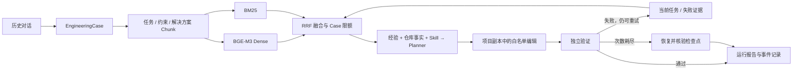

<p align="center">
  <picture>
    <source media="(prefers-color-scheme: dark)" srcset="assets/readme-banner-dark.svg">
    
  </picture>
</p>

# RAG Planning Lab

**让历史工程经验，成为下一次代码变更的依据。**

一个可配置的 RAG Planning 与代码执行参考实现：从历史对话抽取工程案例，
结合混合检索、当前仓库事实与 Skill 生成修改计划，
用真实的文件修改和独立验证决定交付、修复或回滚。

[项目展示页](https://chaomacv.github.io/algorithm-upgrade-rag-agent-demo-zh/) ·
[架构说明](docs/architecture.md) · [评测与取舍](docs/evaluation.md) ·
[接入自己的项目](docs/execution_validation.md) · [技术讲解](docs/project_story.md)

> 展示页通过 GitHub Pages 部署。`showcase/` 保存静态源码，修改 main 后由 Actions 自动发布。
> 当前提供轻量工程参考实现与合成开发集实验，尚无真实业务任务成功率结论。

## 项目解决什么问题

工程经验常散落在历史对话里：字段不兼容、配置没生效、向量模型换了却没重建索引。
单次代码生成容易重复踩坑；单纯检索问答又无法证明修改有效。

这里把“经验检索”嵌入代码修改的闭环，每一轮保留查询、依据、计划、动作与验证结果。



## 值得深入看的设计

| 设计 | 实现 | 为什么需要 |
| --- | --- | --- |
| Schema 对齐的经验建模 | EngineeringCase / KnowledgeChunk | 保留任务、约束、问题、方案与来源 |
| 混合检索 | BGE-M3 + BM25 + RRF | 同时利用语义相似与错误信息、标识符匹配 |
| 上下文覆盖控制 | max_per_case | 避免一个 Case 的多个 Chunk 占满 Top-K |
| 验证驱动的修复 | task + validation failure 再检索 | 下一轮规划带上实际失败证据 |
| 项目适配边界 | ProjectAdapter Protocol | 替换项目执行、验证与回滚实现 |
| 可追溯执行 | JSON 产物 + events.jsonl + HTML 报告 | 从最终状态回查每轮依据及阶段耗时 |

## 先用离线演示理解机制

Python 3.10+，无需下载模型或填写 API Key：

```bash
python -m venv .venv
# Linux/macOS: source .venv/bin/activate
# Windows PowerShell: .venv\Scripts\Activate.ps1
python -m pip install -r requirements-core.txt
python scripts/offline_demo.py outputs/my-first-run
python scripts/offline_demo.py outputs/my-rollback-run --scenario rollback
python -m pytest -q
```

打开 `outputs/my-first-run/report.html` 查看运行证据。每次使用新的输出目录。
离线演示使用 **预设 Planner + Mock embedding**，两轮动作是脚本预定的；
项目副本的文件修改、验证子进程、失败状态与恢复校验实际执行。
它用于演示工作流机制，不衡量 LLM 智能或语义检索质量。

## 接入真实模型

默认配置为 DeepSeek + BGE-M3；可以更换 OpenAI-compatible 服务与本地 Embedding：

```bash
python -m pip install -r requirements.txt
# Linux/macOS，填写自己的 key 后加载：
cp .env.example password.txt
source ./load_deepseek_env.sh
python -m algo_rag_demo.cli --config configs/deepseek_bge_m3.json run \
  --case-dir examples/custom_data/cases \
  --task-file examples/custom_data/task.txt \
  --repository-facts examples/custom_data/repository_facts.txt \
  --retrieval-mode hybrid --max-per-case 1
```

PowerShell 可使用 `$env:DEEPSEEK_API_KEY="your-key"` 设置密钥，再运行 Python 命令。
API 请求按所用服务计费；BGE-M3 首次使用需下载模型。
示例 `NeuralScorer` 是加权打分函数，用于暴露接口迁移问题，并非训练后的神经排序模型。
完整接入自己的目标项目时，应配置可编辑文件与验证命令，或实现 ProjectAdapter。
只检索和规划可添加 `--plan-only`。

## 在同一数据上比较四组检索方案

```bash
python -m algo_rag_demo.evaluation --provider bge-m3 --output-dir outputs/evaluation
# 仅检查评测通路，不用于模型质量比较：
python -m algo_rag_demo.evaluation --provider mock --output-dir outputs/evaluation-smoke
```

20 个手工合成案例，60 个 Chunk，30 条带分级相关性标注的开发查询。
RTX 4090 上实际运行 BGE-M3；各方案关闭成功案例先验，使用相同 Top-5 上下文预算。

| 方案 | Recall@5 | MRR@5 | nDCG@5 | 平均不同 Case 数 |
| --- | ---: | ---: | ---: | ---: |
| Dense | 0.9333 | 0.9111 | 0.9194 | 3.23 |
| BM25 | 0.8667 | 0.9111 | 0.9086 | 3.10 |
| Hybrid / RRF | 0.8833 | 0.9667 | 0.9483 | 3.00 |
| Hybrid + 每 Case 1 条 | 0.9000 | 0.9667 | 0.9516 | 5.00 |

融合与去重改善了首条相关位置和上下文覆盖，但没有全面提高 Recall。
数据与查询共同编写，尚无独立测试集；不能把这些数字理解为业务泛化收益或 Agent 任务成功率。
[指标定义、原始数据和复现条件](docs/evaluation.md)。

## 目录与文档

```text
algo_rag_demo/
  case_pipeline/     对话抽取、Schema、分块
  rag/               Embedding、BM25、索引、RRF、Prompt
  agent/             Planner、Adapter、执行闭环、阶段事件
  evaluation.py      四组消融与逐查询报告
  reporting.py       可独立打开的 HTML 运行报告
benchmarks/          20 个合成案例、30 条分级标注查询
examples/            算法替换示例与自定义数据模板
showcase/            项目展示页静态源码与证据数据
docs/                接入、设计取舍、实验与项目讲解
scripts/             离线演示和真实模型启动脚本
tests/               核心检索、执行、回滚、指标与报告检查
```

- [自定义数据到 Case](docs/03_architecture_for_reuse.md)
- [Case Schema](docs/case_schema.md)
- [RAG Pipeline](docs/rag_pipeline.md)
- [执行与验证接口](docs/execution_validation.md)
- [完整命令](docs/commands.md)
- [展示页部署](showcase/README.md)

文件白名单约束编辑入口，验证命令来自用户配置；执行器不提供操作系统沙箱。
可通过自定义 Adapter 在容器中运行不可信代码。
API key、`password.txt`、`.env`、模型缓存与原始运行目录不提交。
演示和实验数据采用 MIT 许可；保留原仓库版权与贡献记录。

