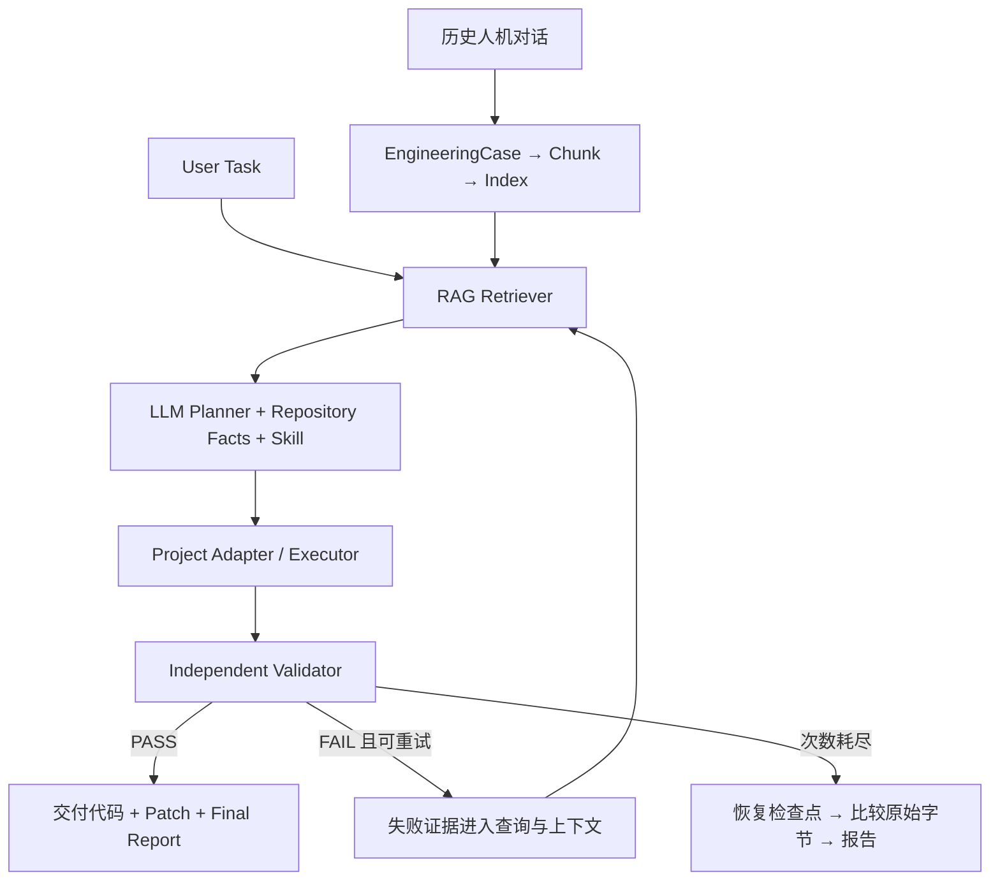

# Algorithm Upgrade RAG Agent

从工程任务出发，检索经验、调用 LLM 生成修改、实际执行，再由独立程序决定交付、重试或回滚。

默认实战：在 **UCI Wine 真实化学测量数据**上，把现有分类服务的标准化最近质心算法升级为 **RandomForestClassifier**，保持接口、返回字段和旧算法回退兼容。模型生成代码，项目不注入正确补丁，也不要求先失败再成功。

[展示页面](https://chaomacv.github.io/algorithm-upgrade-rag-agent-demo-zh/) · [实战全过程](docs/live_practice.md) · [通用架构](docs/architecture.md)

## Quick start：复现真实模型实战

Python 3.10–3.12；需要 DeepSeek API Key，首次运行会下载 BGE-M3（CPU 可运行，GPU 更快）。在仓库根目录执行：

```bash
git clone https://github.com/chaomacv/algorithm-upgrade-rag-agent-demo-zh.git
cd algorithm-upgrade-rag-agent-demo-zh
python -m venv .venv
# Linux / macOS
source .venv/bin/activate
# Windows PowerShell 改为：.\.venv\Scripts\Activate.ps1
python -m pip install -r requirements-practice.txt
export DEEPSEEK_API_KEY="your-key"
# PowerShell 改为：$env:DEEPSEEK_API_KEY="your-key"
python scripts/run_practice.py
```

这一条命令实际完成：加载 178 条 UCI Wine 数据 → 固定分层划分 124 条训练 / 54 条验收 → 读取 12 段人工编写的人机历史对话样例（96 条消息，含相关与干扰内容） → DeepSeek 提取 EngineeringCase → Chunk → BGE-M3 / BM25 / RRF → DeepSeek 生成 Plan / write_file Actions → 写入项目副本 → 独立验收 → 按结果交付或重试，耗尽后恢复检查点。

输出目录由 CLI 打印，为 `outputs/runs/<唯一运行ID>/`：

| 产物 | 用途 |
| --- | --- |
| `run_metadata.json` / `task.json` | 模型配置、源码哈希、环境及原始任务 |
| `conversations/` / `extraction_audit/` / `cases/` | 原始历史对话样例、抽取响应和结构化知识 |
| `knowledge/chunks.json` / `index/` | 实际构建的知识块与索引 |
| `attempts/NN/` | 查询、检索、Prompt、原始模型响应、计划、执行、验收和失败信息 |
| `workspace/` / `checkpoint/` | 修改后的项目副本和修改前字节快照 |
| `delivery/` | 仅在验收通过后导出的文件、SHA-256 清单、`changes.patch` |
| `final_report.json` / `report.html` | 最终状态及可查看的逐轮证据 |

成功次数和尝试轮数不固定。运行失败也会保存证据，不会用脚本补丁改写成成功。API 按实际调用计费。

## 把框架用于自己的业务

按以下入口替换数据和业务适配层，复用检索、规划与流程控制代码：

1. **[Knowledge Preparation：准备自己的知识](docs/knowledge_preparation.md)** — 历史对话、工单、实验日志如何转为有来源的 Case；Schema、Chunk、索引的实际命令。
2. **[RAG Retriever：替换 Embedding / 检索 / 索引](docs/retriever_extensions.md)** — BGE-M3、SentenceTransformers、自定义 Embedding Provider，以及外部检索系统的工厂接口。
3. **[LLM Planner：替换 API](docs/llm_providers.md)** — 更改 Base URL、模型、密钥环境变量；非兼容协议通过 ChatProvider 工厂适配。
4. **[Project Adapter / Executor：接入自己的工程与工具](docs/project_adapter.md)** — 工作副本、白名单文件动作、检查点和交付；Git、Docker、工具框架的接入位置。
5. **[Independent Validator：设计业务验收](docs/validator.md)** — 接口、运行、质量、回归、旧算法兼容；pytest、Hypothesis 等参考与命令接入。
6. **[流程控制与恢复](docs/execution_validation.md)** — PASS / Retry / Exhausted / Rollback 的实际分支及失败产物。

## 可复用架构



`workflow.py` 不包含 Wine 的模型实现或修复答案。业务任务、训练数据和验收程序位于 `examples/wine_service/`；Embedding、检索、ChatProvider 和 ProjectAdapter 均有明确接口。

## 数据与运行证据

业务数据来自 [UCI Wine](https://archive.ics.uci.edu/dataset/109/wine)，178 个样本、13 个化学特征、3 个类别，CC BY 4.0；由 `sklearn.datasets.load_wine` 加载。来源、行划分与文件哈希见 `examples/wine_service/data/manifest.json`。这是公开数据上的工程迁移案例，业务场景由项目设计，不代表客户生产系统。

知识库默认读取 [12 段历史人机对话样例](examples/history_dialogues/README.md)：6 段与分类服务迁移相关、6 段为其他算法迁移的干扰项。它们是人工编写的样例，不冒充真实客户记录；对话中测试反馈不等于独立验收证据。原始对话经 DeepSeek 抽取为 Case，之后分块、建立索引；相关性标注不参与抽取与检索。分类业务数据与 RAG 对话知识完全分开，`prepare_wine.py` 不再生成知识消息。

当前对话语料与 RAG 运行见 [历史对话建库记录](docs/history_dialogues.md)。此前使用诊断知识的运行证据保留在 [早期实战记录](docs/live_practice.md)，不代表当前知识来源。固定留出集用于本案例的验收，重复尝试会接触其汇总反馈；不能将其分数视作独立泛化评估或 RAG 增益实验。

旧的 20 Case / 30 Query 检索实验保留在 `benchmarks/` 与 [检索评测](docs/evaluation.md)，与 Wine 实战独立。`scripts/offline_demo.py` 仅保留为**流程回归用脚本夹具**，不再是默认 Quick start；其中的 ScriptedPlanner / Mock embedding 不参与实战运行。

## 开发检查

```bash
python -m pip install pytest
python -m pytest -q
```

单元测试可以使用受控模型响应来验证失败、重试和回滚分支；这些测试不冒充真实模型实战证据。

文件白名单、受保护验收文件的字节检查和固定命令用于限制操作范围。当前本地执行器不是操作系统沙箱；接入不可信代码时，应在独立容器或虚拟机运行目标工程，并使用外部验收器。[接入说明](docs/project_adapter.md)

## 目录

`algo_rag_demo/` 通用链路 · `examples/wine_service/` 当前业务 · `configs/wine_practice.json` 实战配置 · `scripts/prepare_wine.py` 业务数据与基线快照 · `scripts/run_practice.py` 默认入口 · `tests/` 机制回归 · `showcase/` 中英文展示页
