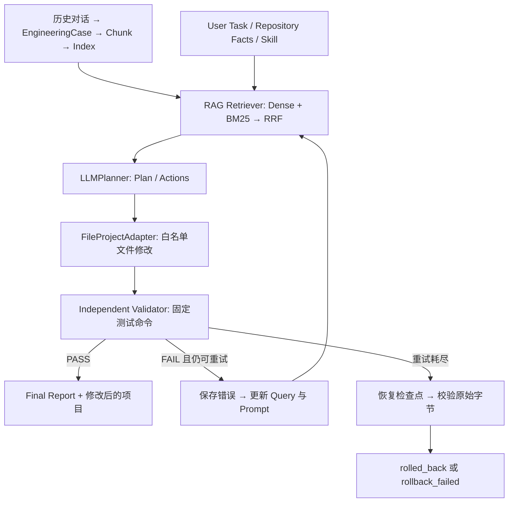

# 从 Agent 架构到 RAG 工程实现

本项目将历史工程经验检索嵌入代码修改的执行闭环。目标是让读者从职责划分找到具体代码，并能下载、运行、检查每轮证据。

## 架构视角

输入任务、仓库事实与 Skill 后，`run_agent()` 调度感知、规划、工具执行、观察和失败反馈。LLM、Prompt 与 RAG 是支持这些职责的组件；它们与图中的模块不是严格的一对一关系。

| Agent 模块 | 职责 | 本项目实现 | 判断 | 范围 |
| --- | --- | --- | --- | --- |
| LLM | 推理与规划的模型能力 | [DeepSeek / OpenAI-compatible Provider](../algo_rag_demo/agent/llm_provider.py) | 已实现 | 模型可替换；不绑定算法场景 |
| Prompt | 组织任务、事实、证据与输出契约 | [prompt_builder.py](../algo_rag_demo/rag/prompt_builder.py) | 已实现 | 经验作参考，当前仓库作事实 |
| RAG | 访问外部经验，支持规划决策 | [BGE-M3 + BM25 + RRF](../algo_rag_demo/rag/retriever.py) | 已实现 | 支持模块过滤与每 Case 数量限制 |
| Planning | 形成步骤与可执行动作 | [LLMPlanner](../algo_rag_demo/agent/planner.py) | 已实现 | 结构化计划和 actions |
| Memory | 长期经验与轮次上下文 | [历史 EngineeringCase + 失败上下文](../algo_rag_demo/case_pipeline/schema.py) | 部分实现 | 尚无新经验自动写回 |
| Tool Use | 模型请求受控工具 | [结构化 write_file Action](../algo_rag_demo/agent/executor.py) | 已实现 | 当前仅提供文件写入工具 |
| Execution | 对环境实施实际操作 | [FileProjectAdapter](../algo_rag_demo/agent/executor.py) | 已实现 | 在运行目录的项目副本中修改 |
| Observation | 获得环境与测试反馈 | [实际执行结果、退出码与测试日志](../algo_rag_demo/agent/trace.py) | 已实现 | 保存 stdout / stderr 与阶段事件 |
| Reflection | 用失败反馈调整后续行为 | [失败信息进入下一轮检索和规划](../algo_rag_demo/agent/workflow.py) | 已实现 | 实现失败反馈；尚无独立反思模型 |
| Orchestration | 调度模块与管理终止条件 | [run_agent()](../algo_rag_demo/agent/workflow.py) | 已实现 | 控制验证、重试、回滚与最终状态 |
| Evaluation | 衡量检索与运行结果 | [检索消融、测试、运行报告](../algo_rag_demo/evaluation.py) | 部分实现 | 合成开发集；尚无独立业务评测 |
| Guardrails | 限制工具、文件与执行范围 | [文件白名单、固定验证命令](../algo_rag_demo/agent/executor.py) | 部分实现 | 当前不提供操作系统级沙箱 |

Perception 对应 CLI 文本输入、仓库代码读取、历史对话的案例抽取与 Schema 校验。Reasoning 由模型在规划上下文中完成。Output 对应修改后的项目副本、`final_report.json` 与 `report.html`。

## 设计思想与实现范围

- [RAG — Lewis et al., 2020](https://arxiv.org/abs/2005.11401)：检索外部知识以支持生成。本项目检索历史 EngineeringCase，为工程规划提供经验依据。
- [ReAct — Yao et al., 2022](https://arxiv.org/abs/2210.03629)：将推理、动作与环境观察相连接。本项目以结构化文件动作、执行反馈与显式调度形成工程循环。
- [Reflexion — Shinn et al., 2023](https://arxiv.org/abs/2303.11366)：利用任务反馈调整后续尝试。本项目已将失败信息加入新一轮查询与规划；尚未实现独立的语言反思器与反思记忆自动写回。

这里是面向当前工程的职责分解与思想对照，不是通用 Agent 的唯一架构，也不表示完整复现上述论文。

## 项目如何运行

控制流见 [workflow.py](../algo_rag_demo/agent/workflow.py)。每次运行先保存检查点，再逐轮检索、规划、执行、验证。只有 `validation.passed is True` 才交付 success。

### 独立验证如何独立

`FileProjectAdapter.validate()` 通过固定的 argv 命令启动子进程，保存退出码、stdout、stderr 或超时信息。示例 [validate.py](../examples/algorithm_upgrade/validate.py) 检查公共接口字段、实际新算法调用、排序和数值回归、旧算法回退。验证命令来自配置，验证脚本不在示例的文件编辑白名单中。

独立性指测试程序独立于 Planner 的成功声明；不是第二个 LLM 审核员，也不表示进程有操作系统级隔离。

### 失败后发生什么

写入 `validation.json` 和 `error_analysis.json`；下一轮查询为原始任务加失败信息，Prompt 同时带入错误上下文。达到次数上限后恢复检查点，逐文件核对原始字节，明确记录恢复成功或失败。

### 复现时应区分的三种证据

1. **离线机制演示**：ScriptedPlanner + Mock embedding，动作预定；文件操作、测试子进程和恢复校验实际执行。
2. **真实模型路线**：LLMPlanner 实际请求模型，BGE-M3 参与检索；具体计划、轮数与成功状态不保证固定。
3. **检索消融**：20 个合成 Case、60 个 Chunk、30 条开发查询。结果用于比较检索方案，不代表 Agent 业务任务成功率。

运行命令见 [README](../README.md)；接入自己的项目见 [执行与验证指南](execution_validation.md)。
